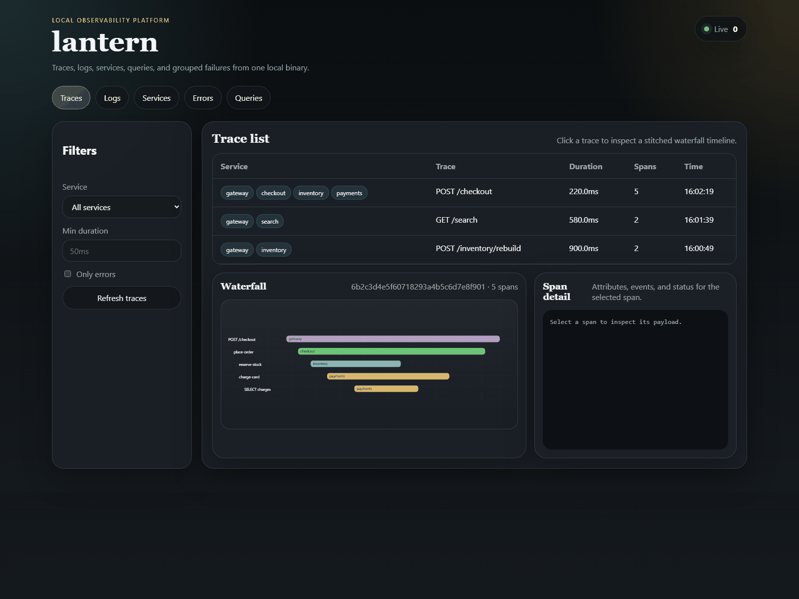
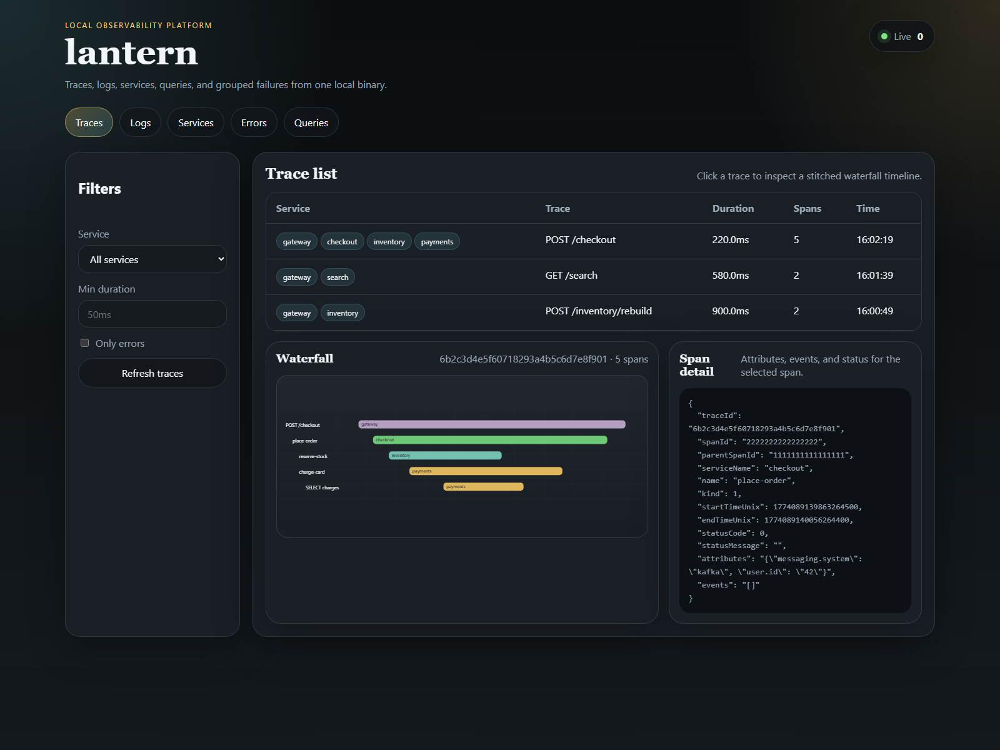
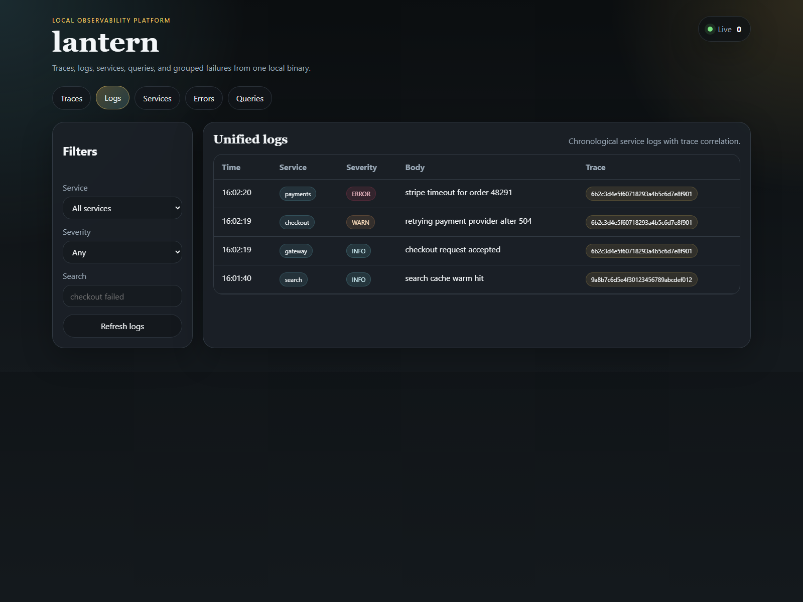
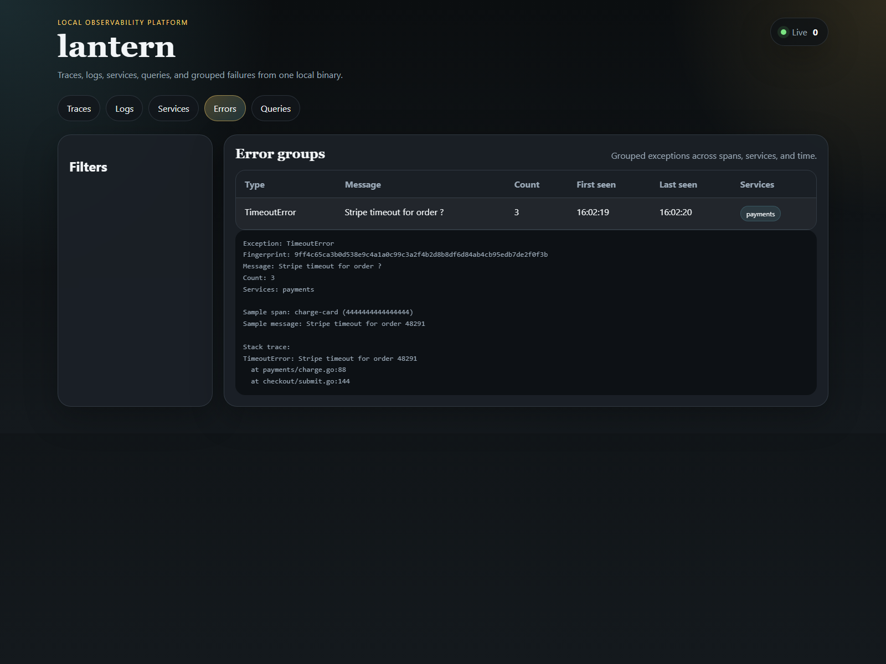

# lantern

`lantern` is a local-first observability platform for developer environments. It runs as a single Go binary, accepts OTLP traces and logs on the standard local ports, stores them in SQLite, and serves a browser UI plus a terminal UI for inspection.

The pitch is intentionally simple: point your OpenTelemetry exporter at `localhost:4317`, run one binary, and inspect traces plus logs without booting a full local observability stack.

Live page: [merup.me/lantern](https://merup.me/lantern/)



Jaeger shows traces. Loki shows logs. Grafana expects a stack around it. `lantern` collapses that setup into one command on your laptop so you can point an OpenTelemetry SDK at `localhost:4317` and start debugging immediately.

## Quick start

```bash
go install github.com/Meru143/lantern/cmd/lantern@latest
lantern serve --no-tui
export OTEL_EXPORTER_OTLP_ENDPOINT=http://localhost:4317
export OTEL_EXPORTER_OTLP_PROTOCOL=grpc
./your-app
```

Open [http://localhost:4000](http://localhost:4000) to inspect traces, logs, services, queries, and grouped errors.
Point your OTEL exporter at `localhost:4317` and run `lantern serve` when you want the browser UI and TUI together in one command.

## Installation

Install the current CLI directly from source:

```bash
go install github.com/Meru143/lantern/cmd/lantern@latest
```

Prebuilt archives for Linux, macOS, and Windows, with a `checksums.txt`, are attached to each [GitHub release](https://github.com/Meru143/lantern/releases). There is no Homebrew formula yet; `brew install lantern` installs an unrelated app.

Run the container image when you want an isolated local instance:

```bash
docker run --rm \
  -p 4317:4317 \
  -p 4318:4318 \
  -p 4000:4000 \
  -v lantern-data:/home/nonroot/.lantern \
  ghcr.io/meru143/lantern
```

If you want a local image from the current checkout instead of the registry release, run `make docker` and start `lantern:dev`.

## Commands

Use `lantern serve` to start the OTLP receiver, the browser UI, and optionally the terminal UI. Add `--no-tui` when you only want the web interface or when you run inside a container.

Use `lantern tui` to open the fullscreen Bubble Tea interface against the local SQLite store. Use `lantern snapshot --last 15m --out checkout.lantern` to export a recent debug bundle, then `lantern replay checkout.lantern --no-tui` to restore it on another machine without the original app still running.

Use `lantern init` to write `~/.lantern/config.toml`, `lantern config show` to print the resolved configuration, and `lantern clear` to wipe the local store and recreate the schema.

## SDK configuration

The fastest path is to use OTEL environment variables and point them at the local gRPC receiver on `localhost:4317`.

### Go

```bash
export OTEL_SERVICE_NAME=checkout-api
export OTEL_EXPORTER_OTLP_ENDPOINT=http://localhost:4317
export OTEL_EXPORTER_OTLP_PROTOCOL=grpc
export OTEL_TRACES_EXPORTER=otlp
export OTEL_LOGS_EXPORTER=otlp
go run ./cmd/checkout
```

### Node.js

```bash
export OTEL_SERVICE_NAME=web-frontend
export OTEL_EXPORTER_OTLP_ENDPOINT=http://localhost:4317
export OTEL_EXPORTER_OTLP_PROTOCOL=grpc
export OTEL_TRACES_EXPORTER=otlp
export OTEL_LOGS_EXPORTER=otlp
node server.js
```

### Python

```bash
export OTEL_SERVICE_NAME=worker
export OTEL_EXPORTER_OTLP_ENDPOINT=http://localhost:4317
export OTEL_EXPORTER_OTLP_PROTOCOL=grpc
export OTEL_TRACES_EXPORTER=otlp
export OTEL_LOGS_EXPORTER=otlp
opentelemetry-instrument python app.py
```

## What the UI shows

The traces view reconstructs a span tree and renders a stitched waterfall so latency bottlenecks stand out without opening a second tool.



The logs view keeps correlated log lines next to their trace IDs so you can jump from a noisy error line to the exact request path that produced it.



The errors view fingerprints repeated failures, groups them across services, and keeps a sample stack trace beside the aggregate row.



## Configuration

`lantern` reads `~/.lantern/config.toml` and the following environment variables:

```bash
LANTERN_DB_PATH
LANTERN_OTLP_GRPC_PORT
LANTERN_OTLP_HTTP_PORT
LANTERN_UI_PORT
LANTERN_RETENTION
LOG_LEVEL
```

`LOG_LEVEL` defaults to `warn`. `--verbose` overrides it and enables debug-level internal logging for runtime troubleshooting.

## Development

Use `make build`, `make test`, `make test-integration`, `make lint`, `make docker`, and `make release-dry` to match the CI and release workflow from this repository. `docker-compose.dev.yml` starts a local `lantern` container plus a small instrumented sample workload. `pwsh -File docs/scripts/run_capture_assets.ps1` refreshes the screenshots and README demo GIF from a running server.

`CONTRIBUTING.md` documents the development loop in more detail.
